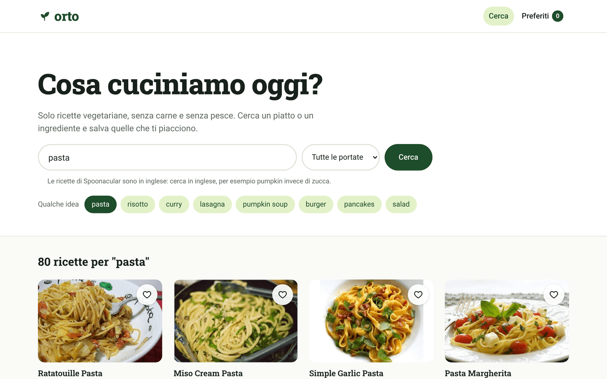
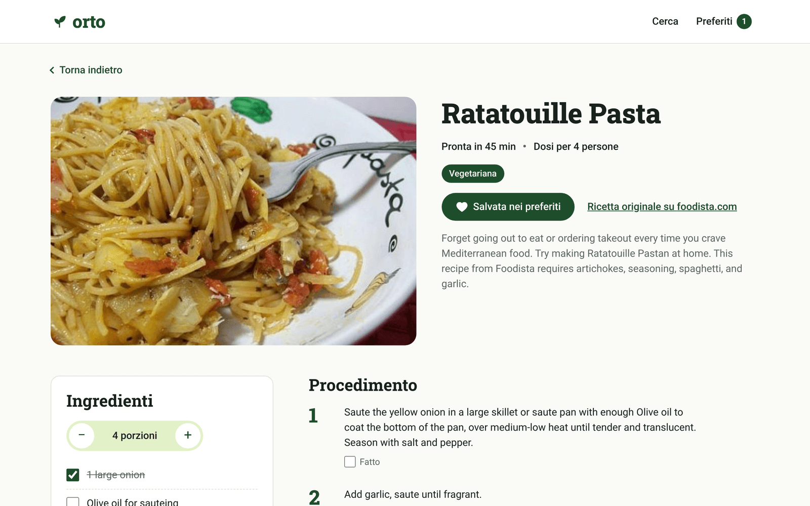
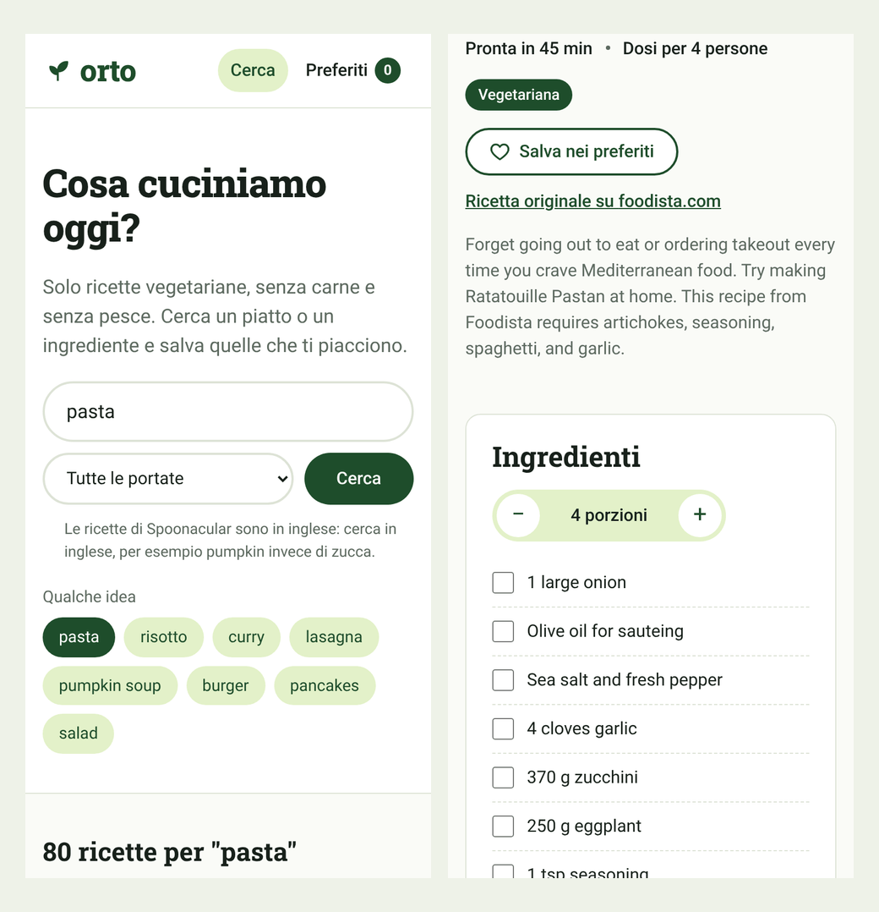
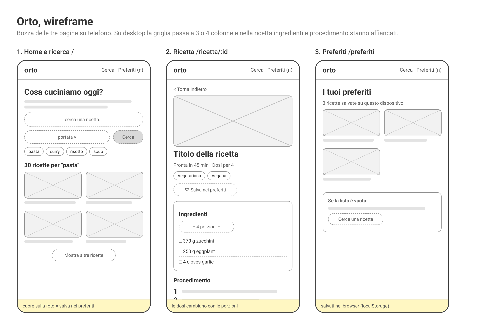

# Orto, ricette vegetariane

Un sito in React per cercare ricette vegetariane, aprirle in una pagina con ingredienti e procedimento e salvare quelle che piacciono. Le ricette arrivano dall'API di [Spoonacular](https://spoonacular.com/food-api). È il progetto React del master start2impact.

## Prova il sito

**https://umbywt.github.io/orto-ricette-vegetariane/**



## Cosa fa

Nella home c'è una barra di ricerca con un filtro per portata (piatti principali, contorni, dolci e così via) e qualche suggerimento da cliccare. I risultati arrivano 12 alla volta, con il pulsante "Mostra altre ricette" per i successivi. Ogni scheda ha foto e titolo e porta alla pagina della ricetta.

Tutte le ricerche partono con `diet=vegetarian`, che per Spoonacular vuol dire niente carne e niente sottoprodotti della carne come gelatina o brodo di ossa. Aggiungo anche `instructionsRequired=true`, così non escono ricette senza procedimento.

Nella pagina della ricetta ci sono tempi, dosi, caratteristiche (vegana, senza glutine, senza latticini), ingredienti con le misure metriche e il procedimento diviso in passaggi. In più:

- si possono cambiare le porzioni e le dosi si ricalcolano
- ingredienti e passaggi si spuntano mentre si cucina
- il cuore salva la ricetta tra i preferiti, che restano nel browser anche chiudendo la pagina
- se qualcuno apre a mano l'indirizzo di una ricetta non vegetariana, il sito non la mostra

La ricerca sta nell'indirizzo (`?q=pasta&portata=dessert`): il tasto indietro del browser riporta ai risultati di prima e un link copiato apre la stessa ricerca.





## Pianificazione

Le funzionalità di partenza:

1. barra di ricerca limitata alle ricette vegetariane, con filtro per portata
2. risultati in griglia con foto e titolo, caricati a blocchi
3. pagina dedicata a ogni ricetta, raggiungibile anche da link diretto
4. preferiti salvati sul dispositivo
5. messaggi chiari per caricamento, nessun risultato ed errori (compresi i punti giornalieri finiti)
6. layout pensato prima per il telefono

Le rotte sono tre più la pagina di errore: `/` per home e ricerca, `/ricetta/:id` per la ricetta, `/preferiti`, e `*` per tutto il resto.



## Tecnologie

- React 19 con Vite
- React Router per le pagine
- Axios per le chiamate a Spoonacular
- Context API e `useReducer` per i preferiti
- hook personalizzati per ricerca, ricetta e preferiti
- CSS Modules, un file di stile per componente
- Vitest e Testing Library per i test
- font Roboto e Roboto Slab installati da NPM con Fontsource

## Struttura

```
src/
├── api/          client Axios e funzioni che parlano con Spoonacular
├── components/   pezzi riusabili: scheda, griglia, barra di ricerca, porzioni...
├── context/      Context dei preferiti e il suo reducer
├── hooks/        useRecipeSearch, useRecipe, useFavorites, useDocumentTitle
├── pages/        Home, Ricetta, Preferiti, Pagina non trovata
├── styles/       colori, font e pulsanti comuni
├── test/         dati di prova presi da risposte vere dell'API
├── utils/        trasformazione dei dati, formati, cache, messaggi di errore
├── App.jsx       elenco delle rotte
└── main.jsx      punto di partenza
```

## Qualche scelta spiegata

I componenti non chiamano mai Axios. Le richieste passano da `src/api/recipes.js`, che trasforma le risposte di Spoonacular in oggetti più semplici, e le pagine le usano attraverso due hook, `useRecipeSearch` e `useRecipe`. Gli hook annullano la richiesta precedente con un `AbortController` quando cambia la ricerca, così una risposta lenta non sovrascrive quella nuova.

Per i preferiti ho scelto il Context invece di Redux. Servono in quattro posti (header, schede, pagina della ricetta, pagina Preferiti), ma sono solo una lista: un reducer e un provider bastano. La ricerca invece non sta nel Context, sta nell'indirizzo.

Il piano gratuito di Spoonacular dà 50 punti al giorno. Una ricerca ne costa circa 1,4 e una ricetta 1. Per non sprecarli la home non fa ricerche da sola all'apertura e le risposte già ricevute vengono tenute in `sessionStorage` per tutta la sessione.

Le quantità usano le misure metriche dell'API e vengono arrotondate in modo leggibile: 465 g diventa 470 g, 1,5 resta 1,5. Gli ingredienti senza una vera quantità ("olio quanto basta") mostrano il testo originale.

## Avvio in locale

Serve Node 22.22 o superiore e una chiave gratuita di Spoonacular (account su [spoonacular.com/food-api/console](https://spoonacular.com/food-api/console)).

```bash
git clone https://github.com/UmbyWT/orto-ricette-vegetariane.git
cd orto-ricette-vegetariane
npm install
cp .env.example .env.local   # poi scrivi la tua chiave dentro .env.local
npm run dev
```

Altri comandi:

```bash
npm test          # tutti i test
npm run build     # versione di produzione nella cartella dist
npm run preview   # la serve in locale per controllarla
```

## Test

Ci sono 69 test in 11 file. Coprono la trasformazione dei dati dell'API (con risposte vere salvate in `src/test/fixtures`), il calcolo delle dosi, i due reducer, la chiamata ad Axios con i parametri giusti, i componenti principali e i flussi delle pagine: ricerca, "Mostra altre", errori, porzioni, preferiti, blocco delle ricette non vegetariane.

## Pubblicazione

Il sito è su GitHub Pages. A ogni push su `main` una GitHub Action lancia i test, fa la build e la pubblica. La chiave API sta nei secret del repository e viene letta solo durante la build.

GitHub Pages non conosce le rotte di React Router: se apri direttamente `/ricetta/657933` cerca un file che non esiste e risponde con `404.html`. Per questo la build copia `index.html` anche in `404.html`, e il router mostra comunque la pagina giusta.

## Limiti che conosco

- Le ricette di Spoonacular sono in inglese, l'interfaccia è in italiano. Anche le ricerche vanno fatte in inglese, e il sito lo dice sotto la barra.
- Se i 50 punti del giorno finiscono, il sito lo spiega con un messaggio e si riparte dalla mezzanotte (ora UTC).
- In un sito fatto solo di frontend la chiave finisce comunque nel JavaScript pubblicato. Per un progetto vero metterei in mezzo un piccolo server che la tiene nascosta.

## Autore

Umberto Brignone

- GitHub: [UmbyWT](https://github.com/UmbyWT)
- LinkedIn: [umberto-brignone](https://www.linkedin.com/in/umberto-brignone/)
