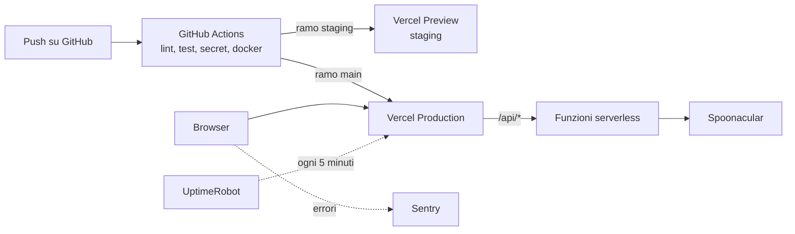

# Orto DevOps


Il progetto DevOps del master start2impact. Ho preso Orto, il sito di ricette vegetariane che avevo fatto per l'esame di React, e gli ho costruito intorno il ciclo completo: container Docker per lavorare in locale, una pipeline su GitHub Actions che controlla ogni push e pubblica da sola, il deploy pubblico su Vercel, il monitoraggio degli errori con Sentry e quello dell'uptime con UptimeRobot.

Il repository parte dalla history del [progetto React](https://github.com/UmbyWT/orto-ricette-vegetariane), così si vede da dove arriva il codice. Quello resta com'era al momento della consegna.

**Sito pubblico: https://orto-devops.vercel.app**


## Indice

1. [L'app vista da chi la deve pubblicare](#lapp-vista-da-chi-la-deve-pubblicare)
2. [Ambienti](#ambienti)
3. [Strumenti scelti](#strumenti-scelti)
4. [Pianificazione](#pianificazione)
5. [Avvio in locale](#avvio-in-locale)
6. [Secrets](#secrets)
7. [Pipeline CI](#pipeline-ci)
8. [Pipeline CD e deploy](#pipeline-cd-e-deploy)
9. [Monitoraggio](#monitoraggio)
10. [Come leggere gli alert](#come-leggere-gli-alert)
11. [Messa in opera da zero](#messa-in-opera-da-zero)
12. [Struttura del repository](#struttura-del-repository)
13. [Limiti e prossimi passi](#limiti-e-prossimi-passi)

## L'app vista da chi la deve pubblicare

Orto è una single page application in React 19 con Vite. Si cerca una ricetta, si apre la sua pagina con ingredienti e procedimento, si cambiano le porzioni, si salvano i preferiti. I dati arrivano dall'API di Spoonacular, che chiede una chiave a ogni richiesta e nel piano gratuito concede 50 punti al giorno.

Guardandola con gli occhi di chi deve metterla online, le cose che contano sono poche:

- il frontend è un insieme di file statici: dopo `npm run build` la cartella `dist` si può servire da qualsiasi web server
- le rotte sono di React Router, quindi il server deve rispondere con `index.html` anche su `/ricetta/657933` o `/preferiti`
- l'unico stato lato utente sono i preferiti nel `localStorage`: non c'è un database da gestire
- c'è un segreto vero, la chiave di Spoonacular

L'ultimo punto era il problema più grosso. Nella versione consegnata per React la chiave stava in una variabile `VITE_`, che Vite scrive dentro il JavaScript pubblicato: chiunque apriva gli strumenti del browser poteva leggerla. Lo avevo scritto io stesso tra i limiti del progetto.

Per questo, prima di parlare di pipeline, ho aggiunto un backend piccolo. Sta in `server/app.js`, è scritto in Node senza dipendenze e fa tre cose: tiene la chiave sul server, inoltra a Spoonacular solo le due chiamate che servono al sito (ricerca e dettaglio della ricetta) e impone il filtro vegetariano, che prima stava nel browser e si poteva togliere. Il frontend adesso chiama `/api/search` e `/api/recipe`, sullo stesso dominio del sito, e nel bundle pubblicato non c'è più nessuna chiave.

Lo stesso codice del backend gira in due posti diversi:

- in locale, dentro un container Docker con un piccolo server `node:http` (`server/index.js`)
- in produzione, come funzioni serverless di Vercel (i tre file nella cartella `api/`)



## Ambienti

| | Development | Staging | Production |
|---|---|---|---|
| Dove gira | il mio computer | Vercel, deploy di anteprima | Vercel, dominio pubblico |
| Come si avvia | `docker compose up` oppure `npm run dev` | push sul ramo `staging` | push sul ramo `main` |
| Chi lo vede | solo io, su `localhost:8080` | chi ha accesso al progetto su Vercel | tutti |
| Chiave di Spoonacular | file `.env` locale | variabili Vercel, ambiente Preview | variabili Vercel, ambiente Production |
| Nome su Sentry | `development` (Sentry spento se manca il DSN) | `staging` | `production` |

Sviluppo in locale, faccio il push su `staging` e guardo l'anteprima. Se va bene unisco `staging` in `main` e la pipeline porta la stessa versione in produzione.

Le anteprime di Vercel sono protette dal login di Vercel. Per uno staging va benissimo: non lo trova un motore di ricerca e non lo usa nessuno per sbaglio.

## Strumenti scelti

### GitHub Actions e non GitLab CI

Il codice di tutto il master sta già su GitHub, e il progetto React aveva già una Action per GitHub Pages. Spostare il repository su GitLab solo per usare la sua CI non aveva senso. Le Actions girano nello stesso posto del codice, i Secrets si configurano nelle impostazioni del repository e gli Environments di GitHub tengono la storia dei deploy di staging e produzione con il link alla run che li ha prodotti. Per un repository pubblico i minuti sono gratuiti.

### Vercel e non GitHub Pages o Netlify

GitHub Pages serve solo file statici: il backend che protegge la chiave non avrebbe avuto un posto dove girare, e saremmo tornati alla chiave nel browser. Netlify con le sue Functions avrebbe funzionato. Ho scelto Vercel per due motivi: le funzioni nella cartella `api/` non chiedono configurazione, e ogni deploy che non va in produzione diventa un'anteprima con il suo indirizzo, che è esattamente quello che serve per lo staging. In più la CDN di Vercel tiene in cache le risposte dell'API (header `s-maxage`): la stessa ricetta aperta da cento persone costa un punto solo.

Il collegamento automatico di Vercel con GitHub l'ho spento (`"git": { "deploymentEnabled": false }` in `vercel.json`). Il deploy lo fa la pipeline con la CLI di Vercel, dopo i controlli. Altrimenti Vercel avrebbe pubblicato anche il codice che non passa il lint.

### Sentry e UptimeRobot

Sentry raccoglie gli errori, con il piano gratuito. Riceve gli errori di JavaScript con lo stack trace, l'ambiente e lo SHA del commit che li ha prodotti, e manda un'email quando compare un problema nuovo.

UptimeRobot, anche lui gratuito, controlla il sito ogni 5 minuti da fuori e manda un'email se non risponde. Avere un controllo esterno serve proprio quando Vercel o la rete hanno problemi, cioè quando tutto il resto potrebbe non funzionare.

## Pianificazione

Prima di scrivere configurazioni ho diviso il lavoro negli step del brief.

| Step | Cosa ho fatto | File |
|---|---|---|
| 1. Esplorazione | analisi dell'app, backend per la chiave, ambienti, scelta degli strumenti | `server/`, `api/`, questo README |
| 2. Containerizzazione | Dockerfile multi-stage del frontend, Dockerfile del backend, compose | `Dockerfile`, `server/Dockerfile`, `docker-compose.yml`, `nginx/` |
| 3. Sicurezza | `.env` fuori dal repository e dalle immagini, controllo della history, GitHub Secrets | `.gitignore`, `.dockerignore`, `.env.example`, `scripts/verifica-log.sh` |
| 4. Pipeline CI | lint, test, scansione dei secret, build dei container con smoke test | `.github/workflows/ci-cd.yml`, `eslint.config.js` |
| 5. Pipeline CD | deploy automatico su Vercel, staging e produzione | `.github/workflows/ci-cd.yml`, `vercel.json` |
| 6. Monitoraggio | Sentry, pagina di errore di prova, endpoint di health per UptimeRobot | `src/monitoring/`, `src/pages/ErrorTestPage.jsx` |

## Avvio in locale

Servono Docker (con Docker Compose v2) oppure Node 22.22 o superiore, e una chiave gratuita di Spoonacular ([spoonacular.com/food-api/console](https://spoonacular.com/food-api/console)).

```bash
git clone https://github.com/UmbyWT/UmbyWT-orto-devops.git
cd UmbyWT-orto-devops
cp .env.example .env    # poi scrivi la chiave dentro .env
```

### Con Docker

```bash
docker compose up --build        # costruisce le due immagini e avvia lo stack
```

Il sito è su http://localhost:8080. Lo stack ha due container:

- `web`: nginx, non root, sulla porta 8080. Serve la build di Vite e passa le richieste `/api/*` al backend
- `api`: il server Node, non root, sulla porta 3001. Non è pubblicato verso l'esterno: si raggiunge solo da `web`, come in produzione

Il Dockerfile del frontend ha due stadi. Il primo installa le dipendenze ed esegue la build con Node, il secondo copia solo la cartella `dist` in un'immagine nginx. Node e `node_modules` restano fuori dall'immagine finale, che compressa pesa circa 25 MB.

I comandi che ho usato per provarlo:

```bash
docker compose up --build -d             # avvio in background
docker compose ps                         # stato e healthcheck dei container
docker compose logs -f api                # log del backend, una riga per richiesta
curl http://localhost:8080/api/health     # {"status":"ok",...}
docker compose exec web sh                # shell nel container del frontend
docker compose down                       # spegne e rimuove i container

docker build -t orto-web .                          # solo l'immagine del frontend
docker build -f server/Dockerfile -t orto-api .     # solo l'immagine del backend
```

Entrambe le immagini hanno un `HEALTHCHECK`. Se manca la chiave il backend risponde 503 su `/api/health` e Docker lo segna `unhealthy`: si vede subito con `docker compose ps`.

### Senza Docker

```bash
npm install
npm run dev:api    # backend su http://localhost:3001, legge .env
npm run dev        # frontend su http://localhost:5173, /api va al backend
```

Altri comandi:

```bash
npm run lint      # ESLint su frontend, backend e configurazioni
npm test          # 96 test di Vitest, frontend e backend
npm run build     # build di produzione in dist/
```

## Secrets

### In locale: il file .env

Tutte le variabili stanno in `.env`, creato copiando `.env.example`. Nel repository c'è solo l'esempio, con i nomi e senza valori.

`.gitignore` esclude `.env` e qualsiasi `.env.*` tranne l'esempio. `.dockerignore` fa lo stesso per il contesto di build di Docker: un `.env` copiato in un'immagine resterebbe leggibile in uno dei suoi layer anche cancellandolo dopo.

Per controllare che nessun `.env` sia mai finito nella history:

```bash
git log --all --name-only --format= | grep -E '(^|/)\.env($|\.)' | sort -u
# deve stampare solo .env.example

git log --all --full-history -- .env
# non deve stampare niente
```

Lo stesso controllo, insieme a [gitleaks](https://github.com/gitleaks/gitleaks) su tutti i commit, gira nella pipeline a ogni push. Prima di affidarmi a questi controlli li ho provati su un repository finto con un token committato per sbaglio: tutti e due lo trovano e fanno fallire il job.

Una distinzione che mi è servita: `SPOONACULAR_API_KEY` non ha il prefisso `VITE_`, quindi Vite non la mette nel JavaScript e la legge solo il backend. Le variabili `VITE_` sono pubbliche per definizione. Ci va solo il DSN di Sentry, che è fatto apposta per stare nel browser.

### Nella pipeline: GitHub Secrets e Variables

In Settings → Secrets and variables → Actions:

| Nome | Tipo | A cosa serve |
|---|---|---|
| `VERCEL_TOKEN` | Secret | permette alla pipeline di pubblicare su Vercel |
| `VERCEL_ORG_ID` | Secret | account Vercel di destinazione |
| `VERCEL_PROJECT_ID` | Secret | progetto Vercel di destinazione |
| `SENTRY_AUTH_TOKEN` | Secret | carica le sourcemap su Sentry (facoltativo) |
| `VITE_SENTRY_DSN` | Variable | DSN del progetto Sentry, finisce nella build |
| `SENTRY_ORG`, `SENTRY_PROJECT` | Variable | dove caricare le sourcemap |
| `PRODUCTION_URL` | Variable | facoltativa: l'indirizzo pubblico, se diverso da `https://orto-devops.vercel.app` |

I Secrets sono cifrati, e GitHub li sostituisce con `***` se compaiono nei log. Le Variables invece si leggono in chiaro: le ho usate solo per valori che non sono segreti.

La chiave di Spoonacular non passa da GitHub. Serve alle funzioni mentre girano, non alla build, quindi sta nelle variabili d'ambiente di Vercel (Production e Preview), segnata come Sensitive.

### Verifica dei log

La CLI di Vercel legge il token dalla variabile d'ambiente `VERCEL_TOKEN`, quindi il token non compare mai nemmeno nella riga di comando. Per verificarlo davvero c'è uno script che scarica il log di una run e ci cerca dentro i valori veri dei secret:

```bash
./scripts/verifica-log.sh <id-della-run>
```

Lo script chiede i valori senza mostrarli a schermo e risponde, per ognuno, se compare nel log. Serve la [CLI di GitHub](https://cli.github.com/) con il login fatto. In alternativa si scarica il log dalla pagina della run (icona dell'ingranaggio → Download log archive) e si cerca il valore con la ricerca del proprio editor.

## Pipeline CI

Il file è `.github/workflows/ci-cd.yml`. Parte a ogni push su `main` e `staging` e a ogni pull request verso `main`. I quattro job di CI girano in parallelo:

| Job | Cosa controlla |
|---|---|
| Lint | ESLint su tutto il codice JavaScript, hadolint sui due Dockerfile |
| Test | i 96 test di Vitest |
| Controllo secret | nessun `.env` nella history, gitleaks su tutti i commit |
| Build container e smoke test | build delle due immagini con `docker compose build`, avvio dello stack, quattro richieste di prova con `curl` |

Lo smoke test controlla quattro cose: nginx serve la home, una rotta di React aperta direttamente non dà 404, il backend risponde attraverso nginx e rifiuta un id non valido. Se un'immagine si costruisce ma poi non parte, la pipeline si ferma qui.

ESLint è configurato con `--max-warnings 0`: anche un avviso blocca la pipeline. Le regole sono quelle consigliate di JavaScript più quelle degli hook di React. Alla prima esecuzione hanno trovato tre `setState` chiamati dentro un `useEffect`, che provocano un render in più a ogni cambio. Li ho corretti prima di attivare la pipeline. La regola `react-refresh` del template di Vite l'ho tolta: riguarda solo il ricaricamento a caldo in sviluppo e non trova bug.

Quando il lint fallisce:

- il job Lint diventa rosso e il log mostra file, riga e regola violata
- `actions/setup-node` trasforma gli errori di ESLint in annotazioni, visibili nella pagina della run e sulle righe del commit
- uno step aggiuntivo scrive nel riepilogo della run che il lint non è passato e che il deploy è bloccato
- i job di deploy dipendono dai quattro job di CI (`needs`), quindi restano grigi e non partono

Per provarlo senza toccare la produzione basta un push sul ramo `staging` con un errore voluto, per esempio una variabile dichiarata e mai usata.

## Pipeline CD e deploy

Se i quattro job di CI sono verdi, parte uno dei due job di deploy:

- push su `staging` → job "Deploy staging": `vercel pull --environment=preview`, `vercel build`, `vercel deploy --prebuilt --environment=preview`. L'indirizzo dell'anteprima finisce nel riepilogo della run e nell'ambiente `staging` di GitHub
- push su `main` → job "Deploy production": le stesse tre fasi con `--prod`. Alla fine un controllo chiama la home e `/api/health` sul dominio pubblico: se il sito non risponde o il backend non ha la chiave, la run diventa rossa anche se Vercel ha accettato il deploy

La build avviene sul runner di GitHub e Vercel riceve il risultato già pronto (`--prebuilt`). Così va online proprio la build che ha passato i controlli. Durante la build la pipeline passa a Vite l'ambiente (`staging` o `production`) e lo SHA del commit, che Sentry usa come release.

Su `main` la `concurrency` non annulla mai una run in corso: un deploy di produzione si lascia finire. Sugli altri rami un push nuovo annulla quello vecchio.

Per tornare indietro dopo un deploy sbagliato: `vercel rollback` dalla CLI, oppure "Promote to Production" su un deploy precedente dalla dashboard di Vercel. Poi si sistema il codice e si rifà il push.

## Monitoraggio

### Uptime con UptimeRobot

Due monitor, tutti e due con controllo ogni 5 minuti e avviso via email:

| Monitor | Tipo | Indirizzo | Va giù quando |
|---|---|---|---|
| orto-devops.vercel.app | HTTP(s) | `https://orto-devops.vercel.app` | il sito non risponde o risponde con un errore |
| Keyword on orto-devops.vercel.app/api/health | Keyword | `https://orto-devops.vercel.app/api/health` | la risposta non contiene `"status":"ok"` |

Il secondo monitor esiste perché il sito può essere online con il backend rotto: le pagine si aprono ma le ricerche falliscono. `/api/health` risponde 503 quando manca la chiave e non costa punti di Spoonacular, perché non la chiama.

### Errori con Sentry

Sentry si attiva solo se c'è `VITE_SENTRY_DSN`: in locale e nei test resta spento. Raccoglie tre tipi di eventi:

- gli errori di render dei componenti, intercettati da un ErrorBoundary nel layout (`src/components/AppErrorBoundary.jsx`). Al posto della pagina bianca compare un riquadro con il codice dell'evento e un pulsante per tornare alla ricerca, mentre header e footer restano al loro posto
- gli errori che sfuggono a tutto, tramite `Sentry.reactErrorHandler()` in `createRoot`
- gli errori delle API che indicano un servizio rotto, con un tag `api_error`

Non tutti gli errori delle API arrivano a Sentry. Una ricetta che non esiste o la rete del telefono che cade dipendono da chi usa il sito e farebbero solo rumore. Vanno a Sentry la chiave non valida (401), la quota finita (402, come warning) e gli errori del backend (5xx). La scelta sta in `classifyApiError` dentro `src/utils/errors.js`, ed è coperta dai test.

Gli eventi non salvano l'indirizzo IP di chi usa il sito. Nel codice c'è `sendDefaultPii: false`, ma da solo non basta (vedi sotto, tra gli intoppi): serve anche l'opzione "Prevent Storing of IP Addresses" nelle impostazioni del progetto su Sentry. Se nella pipeline c'è `SENTRY_AUTH_TOKEN`, la build carica le sourcemap su Sentry e poi le cancella da `dist`: su Sentry lo stack trace punta al file e alla riga del codice sorgente, mentre online non finisce codice leggibile.

### Simulare un errore

Sul sito pubblicato c'è una pagina di servizio, fuori dal menu: https://orto-devops.vercel.app/prova-errore. Il pulsante "Genera un errore di prova" rompe di proposito un componente. Il sito mostra il riquadro di errore con il codice dell'evento e, dopo pochi secondi, su Sentry compare il problema "Errore di prova per Sentry: componente rotto di proposito", con ambiente `production`, release uguale allo SHA del commit e lo stack dei componenti.

## Come leggere gli alert

| Alert | Cosa vuol dire, di solito | Cosa faccio |
|---|---|---|
| UptimeRobot: giù sia il sito sia l'API | Vercel non risponde, oppure un problema di dominio o di rete | guardo [vercel-status.com](https://www.vercel-status.com) e la pagina dei deploy. Se il problema è iniziato con l'ultimo deploy, rollback |
| UptimeRobot: giù solo l'API | il backend risponde 503 (chiave mancante) o va in errore | apro `/api/health` e leggo il campo `problem`. Poi controllo le variabili d'ambiente e i log delle funzioni su Vercel |
| UptimeRobot: tornato su dopo pochi minuti | quasi sempre un problema passeggero | guardo quanto è durato. Se capita spesso cerco una causa |
| Sentry, tag `api_error: chiave-api` | Spoonacular rifiuta la chiave: scaduta, revocata o sbagliata | rigenero la chiave su Spoonacular, la aggiorno su Vercel e rifaccio il deploy |
| Sentry, tag `api_error: quota-esaurita` (warning) | finiti i 50 punti del giorno | niente di urgente, il contatore si azzera a mezzanotte UTC. Se succede spesso valuto la cache o un piano a pagamento |
| Sentry, tag `api_error: backend` | Spoonacular lento o giù (502, 504) | se sono pochi eventi è un problema loro e passa da solo. Se sono tanti controllo i log delle funzioni |
| Sentry, errore senza tag `api_error` | un bug nel codice del frontend | guardo la release (lo SHA del commit) per capire quale deploy l'ha introdotto, poi stack trace e browser. Lo correggo e lo segno come risolto |
| Sentry, "Errore di prova per Sentry" | l'errore simulato da `/prova-errore` | nessuna azione, lo segno come risolto |
| Pipeline rossa su `main` | un controllo è fallito. La produzione resta quella di prima, tranne nell'ultimo step dopo il deploy | apro la run e il job rosso. Se è fallito "Controllo del sito pubblicato", il nuovo deploy è online e non funziona: rollback |

Su Sentry conviene guardare insieme tre cose: quante persone sono coinvolte (users), quando è iniziato (first seen) e in quale release. Un errore nuovo che parte con l'ultimo deploy e tocca tanti utenti è da sistemare subito. Uno vecchio, raro e su un browser strano può aspettare.

## Messa in opera da zero

Le cose da fare una volta sola, nell'ordine in cui le ho fatte.

1. Su GitHub creo il repository pubblico `UmbyWT-orto-devops` e faccio il push di `main`. Poi creo il ramo `staging` con `git push origin main:staging`.
2. Su Vercel accedo con l'account GitHub. Nella cartella del progetto lancio `npx vercel link` e chiamo il progetto `orto-devops`, così l'indirizzo pubblico diventa `orto-devops.vercel.app`. Il comando crea il progetto e scrive `.vercel/project.json` con `orgId` e `projectId`. Il file è nel `.gitignore`.
3. Sempre su Vercel, in Settings → Environment Variables, aggiungo `SPOONACULAR_API_KEY` per Production e Preview e la segno come Sensitive.
4. In Account Settings → Tokens di Vercel creo un token per la pipeline, con una scadenza.
5. Su Sentry creo un progetto React e copio il DSN. Per le sourcemap creo anche un token di organizzazione in Settings → Auth Tokens.
6. Nelle impostazioni del repository GitHub inserisco i valori della tabella nella sezione [Secrets](#nella-pipeline-github-secrets-e-variables).
7. Faccio un push su `main`: la pipeline pensa al primo deploy.
8. Su UptimeRobot creo i due monitor della sezione [Monitoraggio](#uptime-con-uptimerobot).
9. Apro `/prova-errore`, genero l'errore e controllo che arrivi su Sentry.

## Struttura del repository

```
.github/workflows/ci-cd.yml   la pipeline: CI su ogni push, deploy su staging e main
api/                          funzioni serverless di Vercel (search, recipe, health)
server/
├── app.js                    logica del backend, uguale su Docker e su Vercel
├── app.test.js               test del backend
├── index.js                  server Node per il container e per lo sviluppo
└── Dockerfile                immagine del backend
nginx/default.conf.template   nginx del frontend: file statici, rotte di React, proxy /api
scripts/verifica-log.sh       cerca i secret nei log di una run
src/
├── api/                      client Axios verso /api
├── components/               componenti, compreso AppErrorBoundary
├── monitoring/sentry.js      avvio di Sentry e segnalazione degli errori delle API
├── pages/                    Home, Ricetta, Preferiti, Pagina non trovata, Prova errore
└── ...                       hook, context, utilità e test, come nel progetto React
Dockerfile                    immagine del frontend, build multi-stage
docker-compose.yml            ambiente locale: web + api
vercel.json                   build, rewrite per React Router, header, deploy da Git spento
eslint.config.js              regole del lint
.env.example                  le variabili d'ambiente, senza valori
```

## Cosa è andato storto durante la messa in opera

Quattro intoppi veri. I primi due li ha fermati o fatti vedere la pipeline, gli altri due li ho trovati controllando impostazioni ed eventi.

Il primo deploy si è fermato con "Project not found". Il token di Vercel era stato creato con lo scope sbagliato: Vercel ora permette di limitare un token a singoli progetti, e io avevo scelto per errore il progetto della boutique invece di `orto-devops`. Il token funzionava, ma non vedeva il progetto giusto. L'ho capito dal fatto che il token risultava usato pochi secondi prima: il login era andato a buon fine, mancava il permesso. Ho creato un token limitato a `orto-devops` e revocato quello vecchio, che apriva un progetto che non c'entrava niente.

Il secondo problema l'ho visto leggendo il log. Il primo deploy di staging è uscito come "Production" e ha preso il dominio pubblico, perché Vercel promuove in produzione il primo deploy di un progetto. Non ha fatto danni, dato che il codice era lo stesso e il deploy di produzione è arrivato subito dopo. Però il comando non diceva esplicitamente dove andare. Adesso lo dice: `vercel deploy --prebuilt --environment=preview`.

Il terzo riguarda i secret. Il token di Sentry per le sourcemap l'avevo salvato tra le Variables di GitHub invece che tra i Secrets. Le Variables si leggono in chiaro e non vengono mascherate nei log, e la pipeline il token lo cerca tra i Secrets, quindi non l'avrebbe nemmeno trovato. Non è mai finito in una run: l'ho spostato tra i Secrets e ho cancellato la variabile. Ora nelle Variables ci sono solo valori pubblici (`VITE_SENTRY_DSN`, `SENTRY_ORG`, `SENTRY_PROJECT`).

Il quarto l'ho visto nel primo evento di prova su Sentry: c'era il mio indirizzo IP, anche se nel codice avevo messo `sendDefaultPii: false`. Quell'opzione impedisce all'SDK di mandare dati personali, ma Sentry l'IP lo ricava comunque dalla richiesta che riceve. Ho attivato "Prevent Storing of IP Addresses" nelle impostazioni del progetto e generato un secondo errore di prova: l'IP non c'è più, resta solo la città approssimativa.

## Limiti e prossimi passi

- Le immagini Docker si costruiscono e si provano nella pipeline, ma non le pubblico su un registry: in produzione non servono, perché Vercel non usa container. Se un giorno il sito passasse a un server o a un cluster, il passo successivo sarebbe pubblicarle su GitHub Container Registry con lo SHA come tag.
- Sentry è attivo solo sul frontend. Gli errori del backend si vedono indirettamente (il frontend segnala i 5xx) e nei log delle funzioni di Vercel. Il passo successivo sarebbe `@sentry/node` anche nelle funzioni.
- La quota gratuita di Spoonacular resta il limite più stretto. La cache della CDN aiuta molto, ma con molti utenti diversi servirebbe un piano a pagamento.
- Le ricette di Spoonacular sono in inglese, come nel progetto React.

## Autore

Umberto Brignone

- GitHub: [UmbyWT](https://github.com/UmbyWT)
- LinkedIn: [umberto-brignone](https://www.linkedin.com/in/umberto-brignone/)
